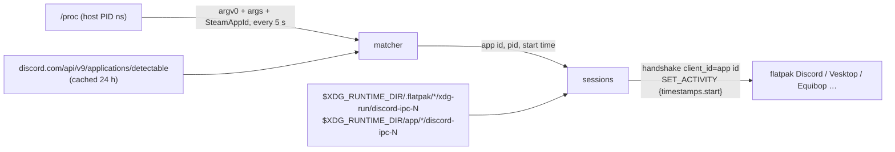

# presence-bridge

Discord Rich Presence for games that a sandboxed (flatpak) Discord client cannot
detect.

A flatpak Discord — or Vesktop, Equibop, Legcord — runs in its own PID namespace.
Its process-scan game detection sees the ~20 processes inside its sandbox, not the
hundreds on the host, so a game started from another flatpak (Faugus, Heroic, Steam,
Lutris, Bottles) is invisible to it. Flatpak has no option to share the host PID
namespace (`--share` accepts only `network` and `ipc`). Games that speak Discord RPC
themselves can still reach the client; games that rely on detection alone — World of
Warcraft holds no Discord socket at all — show nothing.

presence-bridge is a user service on the host that does the detection for the client:
it scans `/proc`, matches games against Discord's own detectable-games list, and
reports each one over the client's IPC socket as if the game had done it.

Background: [starlit-os/krytis#595](https://github.com/starlit-os/krytis/issues/595).

## How it works



- **Clients** are found generically: any app ID with a real socket at
  `.flatpak/<id>/xdg-run/discord-ipc-N` or `app/<id>/discord-ipc-N`, so no client
  list is needed. The `.flatpak/` socket is tried before the `app/` relay the Discord
  flatpak's wrapper creates with `socat`. Only sockets count, checked without
  following links: flatpak leaves an empty regular file at
  `.flatpak/<id>/xdg-run/discord-ipc-N` in every app granted that path (Faugus,
  Proton Mail, GitKraken, …). The canonical `$XDG_RUNTIME_DIR/discord-ipc-N` is
  skipped unless `--include-host`: anything listening there is native and detects
  games itself, so reporting to it would double the activity.
- **Idle when no client runs.** Until a client socket exists the loop only probes for
  one: no `/proc` scan, and the game list is not fetched.
- **Game list.** Discord's public detectable-applications endpoint, the list its own
  client and arRPC use. The response is ~13 MB / ~24.6k apps; only win32 and linux
  non-launcher executables and Steam app IDs are kept, leaving ~19.4k apps in a 3.2 MB
  cache, `detectable-v2.json` under `$CACHE_DIRECTORY` (systemd) or
  `$XDG_CACHE_HOME/presence-bridge/` (measured 2026-10-10). It is refetched
  when older than 24 h, on a worker thread with a 5 min deadline, so sessions keep
  being served with the loaded list meanwhile; a stale cache is used when offline.
- **Matching** copies the rules in [arRPC](https://github.com/OpenAsar/arrpc)'s
  [`process/index.js`](https://github.com/OpenAsar/arrpc/blob/main/src/process/index.js),
  so every title Vesktop/Equibop's built-in detection would detect is detected here:
  lowercase, `\` → `/`, compare every path suffix (and the `64`/`x64`/`_64`-stripped
  variants) against executable names; `>name` must equal the basename; `arguments`
  must appear in the joined argv. It reads **argv0
  from `/proc/<pid>/cmdline`**, not `/proc/<pid>/exe`: Wine and Proton set argv0 to the
  Windows path (`C:\Program Files (x86)\World of Warcraft\_retail_\WoW.exe`), while
  `exe` names only the wine preloader. One deliberate difference: arRPC produces no
  candidate for a bare argv0 with no `/`; here the basename is always a candidate.
- **Steam games by app ID**, a deliberate superset of arRPC, which matches
  executables only (as of 2026-10-09). Most of the list has no executables, but every
  entry carries store IDs, and Steam sets `SteamAppId` in the environment of
  everything it launches, native and Proton alike. A process whose `SteamAppId` is
  an entry's Steam ID is that game. Steam's whole launch tree carries the ID, so the
  game is the lowest PID whose argv0 lies in the game's own directory
  (`STEAM_COMPAT_INSTALL_PATH`), and Steam's `reaper` wrapper stands in until it starts.
  Once the game, or an executable match, has exited, the rest of the tree (Wine's
  services, `reaper`, crash handlers) doesn't keep the title shown.
  A demo has its own app ID, which the list lacks; Steam's local
  `appcache/appinfo.vdf` names its full game, which is shown instead. An executable
  match takes precedence over a Steam match for the same title.
- **Sessions.** One IPC connection per (game, client), because the handshake binds a
  connection to one `client_id`. The game's application ID is the `client_id`, so the
  client renders the game's own name and icon; the activity carries only
  `timestamps.start`, taken from the process start time in `/proc/<pid>/stat`, so
  elapsed time is right when the bridge starts after the game. For an executable
  match, the lowest matching PID stands for a title. When the game exits the bridge
  sends `activity: null` and closes. When a client disappears or its socket hits EOF,
  the session is dropped and retried on the next scan. Anything can listen on a
  discovered socket, so a peer
  cannot hold the loop: the handshake and each `SET_ACTIVITY` get 3 s end to end,
  writes included (pings, and bytes trickled in or drained out slowly, do not extend
  it), and between scans a session reads at most one maximal frame (1 MiB) of
  whatever the peer sends.

Synchronous std I/O, no async runtime: one loop, plus a worker thread for the list
refresh. Dependencies are `serde`, `serde_json`, and `ureq` (rustls) for the one
HTTPS fetch.

## Usage

mise provides the toolchain (Rust 1.98.1, pinned in `mise.toml`) and runs the tasks,
so no Rust outside mise is needed. In a fresh clone or worktree, run `mise trust` once.

```console
$ mise run build              # target/release/presence-bridge
$ mise run dev --once         # build, then scan once and print games and clients
$ mise run dev                # build, then run the service loop in the foreground
$ target/release/presence-bridge --help
usage: presence-bridge [--once] [--interval SECS] [--include-host] [--db FILE]
```

`mise run dev` takes the binary's flags (`--once`, `--interval`, `--include-host`,
`--db`). `--once` scans once and prints the detected games and reachable clients — the
first thing to run when presence does not show up. As a service, install the binary to
`/usr/bin` and `systemd/presence-bridge.service` to `/usr/lib/systemd/user/`, then
`systemctl --user enable --now presence-bridge`.

## Known limitations

- **RPC-capable games may show twice.** A game that already reports through Proton's
  `rpc-bridge` and is also on the detectable list gets a second connection from the
  bridge. Attributing a Discord socket to a game is not cheap — the connection is held
  by `bridge.exe` in the Wine prefix, not by the game — so this is unhandled. Whether
  Discord merges two activities with the same application ID is untested.
- **`pid` is a host PID the client cannot see.** `SET_ACTIVITY` requires a `pid`; the
  bridge sends the game's host PID. arRPC ignores it. What the official client does
  with a PID absent from its namespace is untested.
- **Native Linux titles outside Steam are barely covered**: the detectable list
  carries 8 linux executables against ~11k win32 ones (counted 2026-10-09). Steam's
  native builds are matched by app ID instead (Valheim, 2026-10-10). Whether a native
  Discord client matches by Steam ID is unverified.

## Testing

`mise run lint ::: test` (`:::` separates tasks; `mise run lint test` would pass `test`
to `lint` as an argument, which `lint` rejects). `lint` is `cargo fmt --check`
(`rustfmt.toml`), clippy with warnings as errors, and `usage lint` on every task with a
`#USAGE` spec; `test` is `cargo test --release --locked`, and takes a test filter
(`mise run test ipc::`). After changing a pin in `mise.toml`, run `mise run mise-lock`
and commit `mise.lock`; `mise run mise-lock --check` fails when the committed lockfile
is behind. `mise run docs-links` checks the docs' references.

The tests cover the matcher rules above, Steam matching (which store IDs survive the
trim, the game's PID within a Proton or native launch tree, `SteamAppId=default`, a
title matched both ways, demos in both `appinfo.vdf` formats), client discovery (relay
ordering, empty-file stubs, host-socket opt-in), and a session against an in-process
fake server (handshake, a ping before the reply, the `SET_ACTIVITY` payload, EOF
detection, a 4000 handshake rejection, a ping flood that never sends `READY`, a peer
that never stops sending, a peer that drains a near-1 MiB pong slowly).

Live check, World of Warcraft under Faugus with the Discord flatpak:

1. Start `com.discordapp.Discord` and log in, with activity sharing enabled under
   Settings → Activity Privacy.
2. `mise run dev --once` lists
   `client com.discordapp.Discord: …/.flatpak/com.discordapp.Discord/xdg-run/discord-ipc-0`.
3. Launch WoW from Faugus. `--once` lists
   `game World of Warcraft (356875762940379136) pid …`.
4. Run `mise run dev` and look for
   `World of Warcraft (pid …): reported to com.discordapp.Discord via …`; the Discord
   profile shows "Playing World of Warcraft" with the time since WoW started.
5. Quit WoW: the log says `game exited, cleared`, and the activity disappears within
   one scan interval.

A Steam title checks the same way. With the Guildrun Demo running under Proton
(2026-10-10), `--once` listed `game Guildrun (1529337689047044147) pid …`, the full
game, at the PID of `S:\common\Guildrun Demo\Guildrun.exe`, and the Discord flatpak
showed "Playing Guildrun". Valheim's native build showed as "Playing Valheim".

## License

[MIT](LICENSE). Every dependency is permissively licensed and compatible with it
(`cargo metadata` on 2026-10-09: mostly `MIT OR Apache-2.0`, plus ISC, BSD-3-Clause,
Zlib, Unicode-3.0, and CDLA-Permissive-2.0 for `webpki-roots`).
